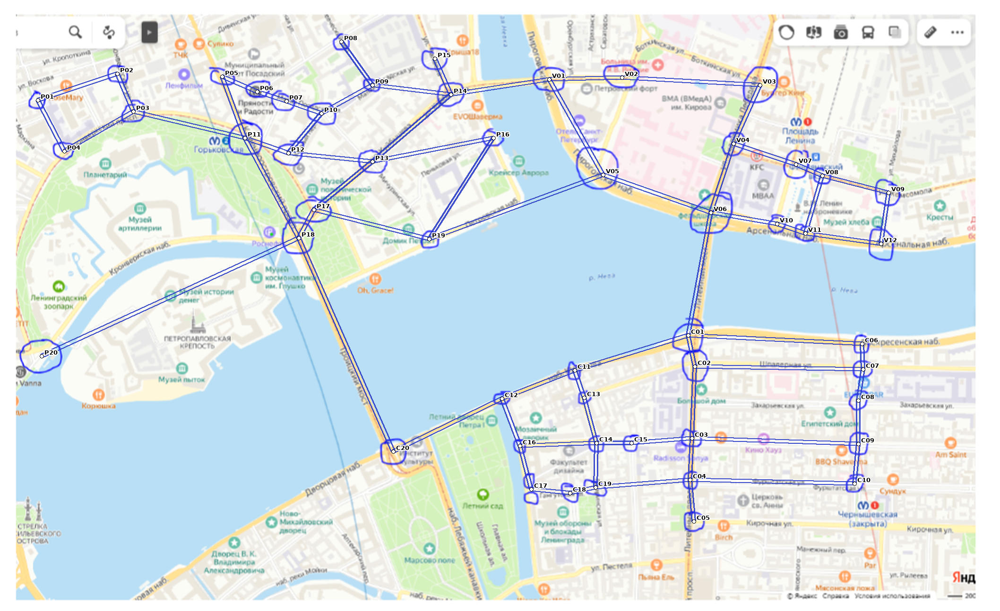
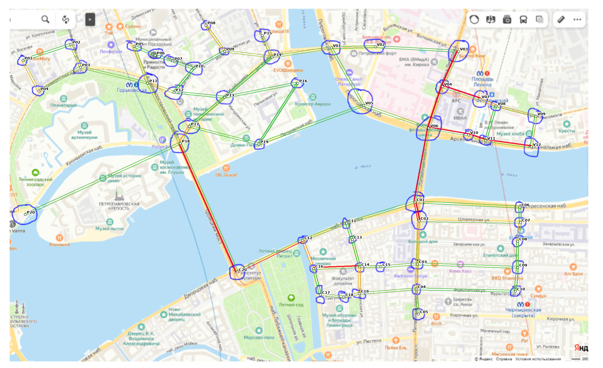
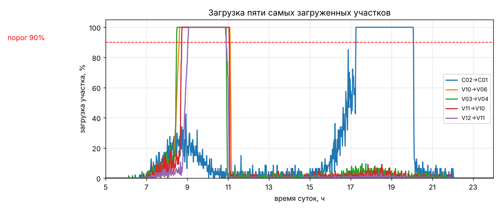
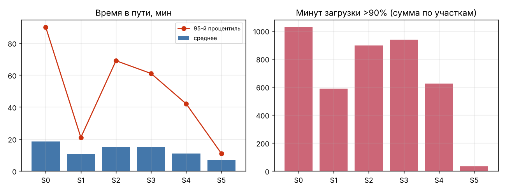

# Лабораторная работа №3: [ГРАФ]: Алгоритмы работы с графами (моделирование транспортной системы)

<p style="text-align:center"><b>Курс:</b> Алгоритмы и структуры данных<br><b>Студент:</b> ______________________ (ФИО, группа)<br><b>Дата:</b> 21 ноября 2026 г.</p>

## 1 Цель

Познакомить студента с инструментами для решения задач, использующих графовые модели, на примере моделирования транспортной системы города: найти узкие места и предложить способы оптимизации.

## 2 Постановка задачи и исходные данные

**Дано.** Изображение карты центральной части Санкт-Петербурга (Петроградская сторона, Выборгская сторона, Литейная часть, Троицкий и Литейный мосты) с отмеченными перекрёстками. Автомобили (агенты) и их маршруты придуманы, предусмотрены утренний и вечерний часы пик.

**Задача 1.** Определить TOP-10 самых загруженных участков между перекрёстками и время рассасывания затора. Для участков показать: количество автомобилей, процент загруженности, длительность высокой загруженности (более 90%).

**Задача 2.** С помощью модели предложить и проверить варианты решения заторов.

**Для задач 1 и 2** рассчитать и обосновать вычислительную и ёмкостную сложность.

### 2.1 Граф дорожной сети

Перекрёстки отмечены на изображении синими кружками. Их центры найдены автоматически (скрипт `tools/detect_nodes.py`: выделение синего цвета и поиск связных областей), получилось **52 перекрёстка** — вершины графа. Участки дорог между соседними перекрёстками — рёбра. Каждая дорога двусторонняя и даёт два направленных участка, всего **72 двусторонних дорог = 144 направленных участков**. Названия перекрёстков указаны по ближайшим подписям на карте (полный список в приложении Б), поэтому они приблизительные. Чтобы не смешивать районы, перекрёстки названы с префиксами: P — Петроградская сторона, V — Выборгская сторона, C — центр (левый берег Невы).

Между берегами есть только два моста: **Троицкий** (P18–C20) и **Литейный** (V06–C01). Именно они определяют поведение всей сети.



Длина участка считается по расстоянию между перекрёстками на изображении в пикселях и масштабу **3,5 м на пиксель**. Масштаб оценён по известной длине мостов (Троицкий около 580 м, Литейный около 400 м) и является приближённым.

### 2.2 Параметры модели (придуманные данные)

| Класс дороги | Дорог (двусторонних) | Суммарная длина, км | Полос в направлении | Скорость без затора, км/ч |
|---|---|---|---|---|
| Мост (bridge) | 2 | 1,3 | 3 | 50 |
| Магистраль (avenue) | 16 | 5,1 | 3 | 50 |
| Улица (street) | 29 | 9,9 | 2 | 40 |
| Местная (local) | 25 | 5,4 | 1 | 30 |

Для каждого участка вычисляются:

- **вместимость** K = число полос · длина / 7,5 м (на машину в заторе приходится 7,5 м: длина автомобиля и дистанция), но не меньше 4;
- **пропускная способность** q = 10 машин в минуту на полосу (с учётом светофоров), то есть до 1 800 машин в час в направлении моста;
- **время проезда без затора** t0 = ⌈длина / скорость⌉ минут (не меньше 1 минуты, шаг моделирования равен минуте).

**Загруженность участка** = (число автомобилей на участке) / (вместимость) · 100%. В число автомобилей входят и стоящие в очереди.

### 2.3 Автомобили и маршруты

Автомобили объединены в **64 группы поездок** «из A в B» (файл `data/flows.csv`). Выезд из жилых районов (Петроградская и Выборгская стороны, пункты P и V) в центр (пункты C) утром и обратный поток вечером — основной, встречные потоки и поездки днём — фоновые. Всего за сутки **26 575 автомобилей**:

| Период | Автомобилей | Время выезда |
|---|---|---|
| Утренний пик | 10 370 | нормальное распределение, максимум в 08:45, σ = 45 мин |
| Вечерний пик | 11 145 | нормальное распределение, максимум в 18:00, σ = 55 мин |
| Дневной фон | 5 060 | равномерно с 07:00 до 22:00 |

Примеры групп (направление «в центр» утром, обратное вечером):

| Откуда → куда | Утром | Вечером | Днём |
|---|---|---|---|
| V03 → C02 (Выборгская сторона → Литейный пр.) | 504 | 101 | 76 |
| P05 → C03 (Каменноостровский пр. → Литейный пр. юг) | 448 | 90 | 67 |
| P05 → C02 | 392 | 78 | 58 |
| C02 → V03 (обратно) | 101 | 554 | 76 |
| C03 → P05 (обратно) | 90 | 493 | 67 |

Маршрут каждого автомобиля — кратчайший по времени путь по графу (алгоритм Дейкстры).

## 3 Модель и алгоритм

### 3.1 Структуры данных

| Что | Как хранится |
|---|---|
| Перекрёстки | `vector<Node>` (id, название, координаты) |
| Участки | `vector<Edge>` (откуда, куда, длина, полосы, вместимость, пропускная способность, время проезда) |
| Граф | списки номеров исходящих `out[v]` и входящих `in[v]` участков для каждого перекрёстка |
| Автомобили | `vector<Agent>` (откуда, куда, минута выезда, минута прибытия, время готовности) |
| Автомобили на участке | очередь `deque<int>` (FIFO, в ней номера автомобилей) на каждый участок |
| Ожидающие выезда | очередь `deque<int>` на каждый перекрёсток |
| Результат | `count[участок][минута]` — сколько машин на участке в каждую минуту (тип `short`) |
| Расстояния до целей | `dist[пункт назначения][перекрёсток]` — время в пути |

### 3.2 Алгоритм моделирования

Время идёт шагами по одной минуте (с 00:00 до 25:00, чтобы все успели доехать). На каждом шаге:

1. **Движение.** Для каждого участка берётся автомобиль из начала очереди. Он покидает участок, если выполнены три условия: он уже проехал участок (прошло t0 минут), с этого участка за минуту уехало меньше q машин, и на следующем участке есть место (иначе образуется очередь, которая растёт назад по сети: «затор»). Если перекрёсток является целью автомобиля, тот прибывает и исчезает.
2. **Выезд.** Автомобили, у которых наступила минута выезда, встают в очередь у своего перекрёстка и въезжают на первый участок маршрута, если там есть место.
3. **Запись.** Для каждого участка запоминается число автомобилей.

### 3.3 Выбор маршрута (алгоритм Дейкстры)

Для каждого пункта назначения один раз запускается **алгоритм Дейкстры по обратным рёбрам**: он даёт кратчайшее время от всех перекрёстков до этой цели сразу. Затем автомобиль на каждом перекрёстке выбирает выезд, где (время участка + оставшееся время до цели) минимально. Разворот назад запрещён.

- **Статический режим:** время участка равно t0 (водитель не знает о заторах).
- **Динамический режим (навигатор):** время участка равно t0 · (1 + 3 · загрузка²), расстояния пересчитываются каждую минуту, поэтому водители объезжают заторы.

### 3.4 Показатели

- **Количество автомобилей на участке** — максимум за сутки и по минутам.
- **Процент загруженности** — максимум за сутки (и график по времени).
- **Длительность высокой загруженности** — сколько минут за сутки загруженность выше 90%.
- **Самый долгий затор** — самый длинный непрерывный период загруженности выше 90%.
- **Время рассасывания** — время от момента, когда загрузка участка впервые достигла максимума, до момента, когда она опустилась ниже 90% (конец самого долгого затора).

**Рейтинг TOP-10**: участки сортируются по длительности высокой загруженности, при равенстве — по максимальной загруженности.

## 4 Задача 1. TOP-10 самых загруженных участков

| № | Участок | Улица | Вмести-мость, авто | Макс. авто на участке | Макс. загрузка, % | Минут >90% за сутки | Самый долгий затор | Рассасывание, мин |
|---|---|---|---|---|---|---|---|---|
| 1 | C02->C01 | Литейный пр. | 47 | 47 | 100.0 | 169 | 17:16–20:05 | 169 |
| 2 | V10->V06 | Арсенальная наб. | 99 | 99 | 100.0 | 149 | 08:37–11:06 | 148 |
| 3 | V03->V04 | ул. Академика Лебедева | 63 | 63 | 100.0 | 146 | 08:29–10:55 | 145 |
| 4 | V11->V10 | Арсенальная наб. | 44 | 44 | 100.0 | 140 | 08:44–11:04 | 139 |
| 5 | V12->V11 | Арсенальная наб. | 113 | 113 | 100.0 | 113 | 09:02–10:55 | 110 |
| 6 | V04->V06 | ул. Академика Лебедева | 71 | 71 | 100.0 | 100 | 08:25–10:03 | 98 |
| 7 | V06->C01 | Литейный мост | 185 | 184 | 99.5 | 82 | 08:30–08:36 | 6 |
| 8 | C14->C16 | ул. Чайковского | 75 | 75 | 100.0 | 55 | 18:04–18:59 | 53 |
| 9 | V07->V04 | пл. Ленина | 64 | 64 | 100.0 | 37 | 08:46–09:21 | 34 |
| 10 | P18->C20 | Троицкий мост | 345 | 337 | 97.7 | 16 | 09:26–09:39 | 9 |

Загруженность выше 90% — высокая; 100% означает, что участок полностью заполнен и дальше не принимает машины.





**Выводы по задаче 1:**

1. **Утром (08:25–11:06)** затор образуется на Выборгской стороне: Арсенальная наб. (V12→V11→V10→V06) и ул. Академика Лебедева (V03→V04→V06). Все эти участки ведут к Литейному мосту: поток из района превышает его пропускную способность (30 авто/мин), и очередь растёт назад от моста на 1,5–2,5 часа (затор на этих участках длится от 100 до 149 минут).
2. **Вечером (17:16–20:05)** затор образуется на Литейном проспекте (C02→C01) на пути к мосту в обратную сторону, а также на ул. Чайковского (C14→C16).
3. **Сам мост** (V06→C01) заполняется до 99,5%: суммарно 82 минуты выше порога 90%, но короткими периодами (самый долгий — 6 минут, 08:30–08:36). Основная очередь стоит перед мостом, на подъездах, поэтому узким местом является пропускная способность моста.
4. **Троицкий мост** (P18→C20) загружен заметно слабее Литейного: выше 90% всего 16 минут (09:26–09:39), в остальное время у него есть запас пропускной способности. Через него едут только жители Петроградской стороны.
5. Время рассасывания подъездных участков — **от 98 до 169 минут** (1,6–2,8 часа), у мостов — 6 и 9 минут. Затор исчезает только после спада потока утреннего или вечернего пика.

## 5 Задача 2. Варианты решения заторов

Все сценарии запускаются на одних и тех же данных (одинаковый набор автомобилей), меняется только конфигурация. Сравниваются суммарная длительность высокой загруженности по всем участкам и время в пути автомобилей.

| Сценарий | Мера | Как моделируется |
|---|---|---|
| S0 | Базовый (без изменений) | статические маршруты |
| S1 | Навигатор | водители объезжают заторы (динамический выбор маршрута) |
| S2 | +1 полоса на 5 самых загруженных участках (мосты расширять нельзя) | вместимость и пропускная способность растут на 1 полосу |
| S3 | Адаптивные светофоры у Литейного моста | пропускная способность +25% на всех участках у перекрёстков V06 и C01 |
| S4 | Гибкий график работы | пики размазаны по времени: σ утром 45 → 60 мин, вечером 55 → 70 мин |
| S5 | Комплекс мер без строительства: S1 + S3 + S4 | всё вместе |

| Сценарий | Участков, где было >90% | Сумма минут >90% по всем участкам | Среднее время в пути, мин | 95-й процентиль, мин | Расчёт, мс |
|---|---|---|---|---|---|
| S0 Базовый сценарий | 12 | 1027 | 18.6 | 90 | 11 |
| S1 Навигатор (объезд заторов) | 23 | 588 | 10.4 | 21 | 112 |
| S2 +1 полоса на 5 участках | 12 | 895 | 15.0 | 69 | 7 |
| S3 Светофоры у Литейного моста +25% | 12 | 938 | 14.9 | 61 | 6 |
| S4 Гибкий график работы | 7 | 624 | 11.0 | 42 | 7 |
| S5 Комплекс S1+S3+S4 | 5 | 33 | 7.0 | 11 | 112 |

Минуты высокой загруженности (>90%) на участках из TOP-10 в каждом сценарии:

| Участок | S0 | S1 | S2 | S3 | S4 | S5 |
|---|---|---|---|---|---|---|
| C02->C01 Литейный пр. | 169 | 26 | 93 | 114 | 141 | 1 |
| V10->V06 Арсенальная наб. | 149 | 94 | 143 | 145 | 114 | 0 |
| V03->V04 ул. Академика Лебедева | 146 | 0 | 142 | 141 | 98 | 0 |
| V11->V10 Арсенальная наб. | 140 | 80 | 129 | 136 | 99 | 0 |
| V12->V11 Арсенальная наб. | 113 | 48 | 75 | 109 | 60 | 0 |
| V04->V06 ул. Академика Лебедева | 100 | 88 | 100 | 93 | 62 | 0 |
| V06->C01 Литейный мост | 82 | 8 | 82 | 81 | 50 | 0 |
| C14->C16 ул. Чайковского | 55 | 1 | 56 | 56 | 0 | 0 |
| V07->V04 пл. Ленина | 37 | 56 | 39 | 25 | 0 | 0 |
| P18->C20 Троицкий мост | 16 | 0 | 16 | 16 | 0 | 0 |



**Выводы по задаче 2:**

1. **S2 (дополнительные полосы)** даёт скромный эффект: суммарная длительность высокой загрузки уменьшилась на 13% (1027 → 895 мин), среднее время в пути 18,6 → 15,0 мин. Выигрыш получен в основном на Литейном проспекте (C02→C01: 169 → 93 мин), а на подъездах к мосту со стороны Выборгской стороны затор остался: пропускная способность узкого места — моста — не изменилась, дополнительные полосы лишь вмещают больше очереди. Это самая дорогая мера при скромном эффекте.
2. **S1 (навигатор)** — сильная мера: суммарное время затора на 43% меньше (1027 → 588 мин), время в пути сокращается (18,6 → 10,4 мин в среднем, 95-й процентиль 90 → 21 мин). Но затор распределяется по большему числу участков (12 → 23), потому что поток уходит на объезды.
3. **S3 (светофоры у моста)** сокращает время в пути на 20% (18,6 → 14,9 мин) без строительства, но суммарное время затора уменьшается лишь на 9%: в одиночку мера не решает проблему.
4. **S4 (гибкий график работы)** — по эффекту вторая после навигатора и при этом не требует затрат на дорогах: затор сокращается на 39% (1027 → 624 мин), время в пути на 41%. Пик «размазывается», и спрос реже превышает пропускную способность.
5. **S5 (комплекс S1 + S3 + S4)** почти полностью устраняет заторы: **1027 → 33 мин (−97%)**, среднее время в пути 18,6 → 7,0 мин (−62%), 95-й процентиль 90 → 11 мин. Остаются 5 участков с кратковременной высокой загрузкой.

**Рекомендации:** (1) начинать с дешёвых мер: гибкий график работы и информирование водителей об объездах (навигаторы, табло); (2) оптимизировать светофоры на подходах к Литейному мосту; (3) расширение подъездов даёт малый эффект, пока не растёт пропускная способность самих мостов.

## 6 Оценка сложности

**Обозначения:** V = 52 — перекрёстки, E = 144 — участки, T = 1740 — шагов (минут) моделирования, A = 26 575 — автомобили, D = 32 — различных пунктов назначения, M = 191 305 — общее число переездов между участками (в среднем 7,2 участка на машину).

### Вычислительная сложность

| Этап | Сложность | Для наших данных |
|---|---|---|
| Создание автомобилей | O(A) | 2,7 · 10⁴ |
| Выбор маршрутов: Дейкстра для каждой цели (один раз) | O(D · E · log V) | ≈ 2,6 · 10⁴ |
| Движение: проход по участкам на каждом шаге | O(T · E) | 2,5 · 10⁵ |
| Переезды машин (на каждый — выбор из ≈3 выездов) | O(M · deg) | ≈ 5,7 · 10⁵ |
| Подсчёт показателей | O(E · T) | 2,5 · 10⁵ |
| **Статический сценарий (задача 1)** | **O(D·E·log V + T·E + M)** | **≈ 10⁶ операций, 7–11 мс** |
| Динамический режим: пересчёт Дейкстры на каждом шаге | + O(T · D · E · log V) | ≈ 4,6 · 10⁷, около 112 мс |

**Задача 2:** запуск k сценариев — это k независимых моделирований, поэтому O(k · (T·E + M)) для статических и O(k · T · D · E · log V) для динамических. В нашем случае 6 сценариев, из них 2 динамических: общее время около 0,25 с (измерено). Основную часть времени динамического режима занимает повторный запуск алгоритма Дейкстры на каждом шаге.

Для сравнения: без графового алгоритма пришлось бы перебирать все пути между перекрёстками (экспоненциально много).

### Ёмкостная сложность

| Структура | Память | Для наших данных |
|---|---|---|
| Граф (вершины, участки, списки смежности) | O(V + E) | несколько КБ |
| Загрузка участков по минутам `count` | O(E · T) | 144 · 1740 · 2 байта ≈ **0,50 МБ** |
| Автомобили | O(A) | 26 575 · 20 байт ≈ 0,5 МБ |
| Очереди участков и выезда, номера участков | O(A) | ≈ 0,3 МБ |
| Расстояния до целей `dist` | O(D · V) | 32 · 52 · 8 байт = 13 КБ |
| **Итого на один сценарий** | **O(E·T + A)** | **≈ 1,3 МБ** |

Память одного сценария не зависит от числа сценариев, если результаты не сохранять (в программе хранятся все 6 результатов, поэтому около 8 МБ).

Время и память растут линейно с числом автомобилей и длиной суток: модель можно масштабировать на сотни тысяч автомобилей.

## 7 Ограничения модели

- Данные придуманы, а не измерены; результаты показывают качественную картину и относительный эффект мер.
- Модель макроскопическая: фазы светофоров, повороты, перестроения и пешеходы не учитываются, их заменяет пропускная способность участка.
- Структура дорог построена по изображению (соединения перекрёстков оценены по карте), масштаб приблизительный.
- Время одного шага — минута, поэтому участки короче минуты проезда приравниваются к одной минуте.
- Время рассасывания определено для самого долгого затора за сутки.

## 8 [SAVE] Сохранение в репозиторий

Всё, что было сделано в шагах 1 и 2, сохранено в репозиторий, отчёт помещён в папку `doc`.

```
lab3-traffic/
├── src/
│   ├── graph.hpp        # перекрёстки, участки, чтение данных, алгоритм Дейкстры
│   ├── sim.hpp          # агенты, моделирование, показатели участков
│   └── main.cpp         # задача 1 (TOP-10) и задача 2 (сценарии), вывод и файлы результатов
├── data/
│   ├── map.png          # исходное изображение
│   ├── nodes.csv        # 52 перекрёстка (название и координаты на карте)
│   ├── edges.csv        # 72 дорог (класс и улица)
│   └── flows.csv        # 64 группы поездок (утро / вечер / день)
├── results/             # результаты расчёта (CSV)
├── tools/
│   ├── detect_nodes.py  # поиск перекрёстков на изображении
│   └── draw_map.py      # карта загрузки и графики
├── doc/
│   ├── report.pdf
│   └── report.md
├── Makefile
└── README.md
```

Сборка и запуск: `make run`.

## 9 Вывод

Транспортная сеть города естественно описывается графом: перекрёстки — вершины, участки дорог — рёбра с вместимостью и пропускной способностью. Алгоритм Дейкстры используется для выбора маршрутов (один запуск по обратным рёбрам на каждую цель), а пошаговая модель с очередями на участках показывает, как образуются и рассасываются заторы. В модели выявлены узкие места — Литейный мост и подъезды к нему, где затор держится от 1,6 до 2,8 часа. Сравнение сценариев показало, что дорогое расширение подъездов бесполезно, пока не растёт пропускная способность моста, а комплекс «навигатор + светофоры + гибкий график» сокращает время высокой загрузки на 97%. Затраты модели невелики: около 10⁶ операций и 1,3 МБ памяти на сценарий для 26 575 автомобилей.

## Приложение А. Исходный код

### src/graph.hpp

```cpp
// ЛР №3. Граф дорожной сети: перекрёстки (вершины) и участки дорог между ними (рёбра).
#pragma once

#include <algorithm>
#include <cmath>
#include <fstream>
#include <functional>
#include <limits>
#include <map>
#include <queue>
#include <sstream>
#include <stdexcept>
#include <string>
#include <vector>

// ---------------------------------------------------------------------------
// Параметры модели (все данные придуманы для лабораторной работы)
// ---------------------------------------------------------------------------
const double METERS_PER_PIXEL = 3.5;  // масштаб карты (оценён по длине Троицкого и Литейного мостов)
const double CAR_SPACE = 7.5;         // сколько места занимает машина в заторе, м (длина + дистанция)
const int FLOW_PER_LANE = 10;         // сколько машин в минуту пропускает одна полоса (с учётом светофоров)

// Перекрёсток
struct Node {
    std::string id, name;
    double x, y;          // координаты на изображении, пиксели
};

// Участок дороги между двумя перекрёстками (в одну сторону)
struct Edge {
    int from, to;         // номера перекрёстков
    std::string cls;      // класс дороги: bridge, avenue, street, local
    std::string street;   // название улицы
    double length;        // длина, м
    int lanes;            // число полос в этом направлении
    int capacity;         // вместимость: сколько машин помещается на участке
    int flow;             // пропускная способность: сколько машин в минуту могут покинуть участок
    int t0;               // время проезда без затора, мин (не меньше 1)
};

// Число полос и скорость по классу дороги
inline int lanesOfClass(const std::string& c) {
    if (c == "bridge" || c == "avenue") return 3;
    if (c == "street") return 2;
    return 1;
}
inline double speedOfClass(const std::string& c) {   // км/ч
    if (c == "bridge" || c == "avenue") return 50;
    if (c == "street") return 40;
    return 30;
}

// Пересчитывает вместимость и пропускную способность участка по числу полос
inline void setLanes(Edge& e, int lanes) {
    e.lanes = lanes;
    e.capacity = std::max(4, static_cast<int>(lanes * e.length / CAR_SPACE));
    e.flow = lanes * FLOW_PER_LANE;
}

struct Graph {
    std::vector<Node> nodes;
    std::vector<Edge> edges;                  // направленные участки
    std::vector<std::vector<int>> out, in;    // номера исходящих и входящих участков для каждого перекрёстка
    std::map<std::string, int> index;         // "P05" -> номер вершины

    std::string edgeName(int e) const {
        return nodes[edges[e].from].id + "->" + nodes[edges[e].to].id;
    }
};

// Разбивает строку CSV по запятым
inline std::vector<std::string> splitCsv(const std::string& line) {
    std::vector<std::string> parts;
    std::stringstream ss(line);
    std::string item;
    while (std::getline(ss, item, ',')) parts.push_back(item);
    return parts;
}

// Читает перекрёстки и дороги. Каждая дорога из edges.csv даёт два направленных участка.
inline Graph loadGraph(const std::string& nodesFile, const std::string& edgesFile) {
    Graph g;
    std::ifstream fn(nodesFile);
    if (!fn) throw std::runtime_error("Не открывается " + nodesFile);
    std::string line;
    std::getline(fn, line);                   // заголовок
    while (std::getline(fn, line)) {
        if (line.empty()) continue;
        auto p = splitCsv(line);
        g.index[p[0]] = static_cast<int>(g.nodes.size());
        g.nodes.push_back({p[0], p[1], std::stod(p[2]), std::stod(p[3])});
    }

    std::ifstream fe(edgesFile);
    if (!fe) throw std::runtime_error("Не открывается " + edgesFile);
    std::getline(fe, line);
    while (std::getline(fe, line)) {
        if (line.empty()) continue;
        auto p = splitCsv(line);
        int a = g.index.at(p[0]), b = g.index.at(p[1]);
        double len = std::hypot(g.nodes[a].x - g.nodes[b].x, g.nodes[a].y - g.nodes[b].y) * METERS_PER_PIXEL;
        for (int dir = 0; dir < 2; dir++) {
            Edge e;
            e.from = dir == 0 ? a : b;
            e.to = dir == 0 ? b : a;
            e.cls = p[2];
            e.street = p[3];
            e.length = len;
            setLanes(e, lanesOfClass(e.cls));
            double metersPerMin = speedOfClass(e.cls) * 1000.0 / 60.0;
            e.t0 = std::max(1, static_cast<int>(std::ceil(len / metersPerMin)));
            g.edges.push_back(e);
        }
    }

    g.out.assign(g.nodes.size(), {});
    g.in.assign(g.nodes.size(), {});
    for (int i = 0; i < static_cast<int>(g.edges.size()); i++) {
        g.out[g.edges[i].from].push_back(i);
        g.in[g.edges[i].to].push_back(i);
    }
    return g;
}

// Алгоритм Дейкстры "в обратную сторону": кратчайшее время от КАЖДОГО перекрёстка до перекрёстка dest.
// w[e] - время проезда участка e. Один запуск даёт ответ для всех начальных точек сразу.
inline std::vector<double> distancesTo(const Graph& g, int dest, const std::vector<double>& w) {
    const double INF = std::numeric_limits<double>::infinity();
    std::vector<double> dist(g.nodes.size(), INF);
    using Item = std::pair<double, int>;
    std::priority_queue<Item, std::vector<Item>, std::greater<Item>> pq;
    dist[dest] = 0;
    pq.push({0.0, dest});
    while (!pq.empty()) {
        auto [d, v] = pq.top();
        pq.pop();
        if (d > dist[v]) continue;
        for (int e : g.in[v]) {                   // идём против направления дорог
            int u = g.edges[e].from;
            if (d + w[e] < dist[u]) {
                dist[u] = d + w[e];
                pq.push({dist[u], u});
            }
        }
    }
    return dist;
}
```

### src/sim.hpp

```cpp
// ЛР №3. Моделирование движения: агенты (автомобили) едут по графу, на участках образуются очереди.
#pragma once

#include <algorithm>
#include <deque>
#include <random>

#include "graph.hpp"

const int DAY_MINUTES = 1440;        // сутки
const int SIM_MINUTES = 1440 + 300;  // + 5 часов, чтобы все машины успели доехать
const double HIGH_LOAD = 0.90;       // порог "высокой загруженности"

// ---------------------------------------------------------------------------
// Исходные данные: потоки и агенты
// ---------------------------------------------------------------------------
struct Flow {                // группа поездок "из A в B"
    int from, to;
    int morning, evening, day;   // сколько машин выезжает в утренний пик, вечерний пик и в течение дня
};

struct Agent {               // один автомобиль
    int origin, dest;        // откуда и куда едет
    int depart;              // минута выезда
    int arrive = -1;         // минута прибытия (-1 - ещё в пути)
    int ready = 0;           // с какой минуты может покинуть текущий участок
};

inline std::vector<Flow> loadFlows(const Graph& g, const std::string& file) {
    std::vector<Flow> flows;
    std::ifstream f(file);
    if (!f) throw std::runtime_error("Не открывается " + file);
    std::string line;
    std::getline(f, line);
    while (std::getline(f, line)) {
        if (line.empty()) continue;
        auto p = splitCsv(line);
        flows.push_back({g.index.at(p[0]), g.index.at(p[1]), std::stoi(p[2]), std::stoi(p[3]), std::stoi(p[4])});
    }
    return flows;
}

// Параметры времени выезда (минуты от полуночи).
struct Profile {
    double morningPeak = 8 * 60 + 45;   // утренний пик: 08:45
    double eveningPeak = 18 * 60;       // вечерний пик: 18:00
    double sigmaMorning = 45;           // разброс времени выезда утром, мин
    double sigmaEvening = 55;           // разброс времени выезда вечером, мин
};

// Создаёт агентов: время выезда в пиках распределено нормально, днём - равномерно с 07:00 до 22:00.
inline std::vector<Agent> makeAgents(const std::vector<Flow>& flows, const Profile& pr, unsigned seed) {
    std::mt19937 gen(seed);
    std::vector<Agent> agents;
    auto normalTime = [&](double mean, double sigma) {
        std::normal_distribution<double> nd(mean, sigma);
        while (true) {
            int t = static_cast<int>(std::lround(nd(gen)));
            if (t >= 5 * 60 && t < 23 * 60) return t;   // выезды только с 05:00 до 23:00
        }
    };
    std::uniform_int_distribution<int> uni(7 * 60, 22 * 60);
    for (const Flow& f : flows) {
        for (int i = 0; i < f.morning; i++) agents.push_back({f.from, f.to, normalTime(pr.morningPeak, pr.sigmaMorning)});
        for (int i = 0; i < f.evening; i++) agents.push_back({f.from, f.to, normalTime(pr.eveningPeak, pr.sigmaEvening)});
        for (int i = 0; i < f.day; i++) agents.push_back({f.from, f.to, uni(gen)});
    }
    return agents;
}

// ---------------------------------------------------------------------------
// Результат моделирования
// ---------------------------------------------------------------------------
struct SimResult {
    std::vector<std::vector<short>> count;   // count[участок][минута] - сколько машин на участке
    std::vector<Agent> agents;
    long long moves = 0;                     // сколько раз машины переехали с участка на участок (для оценки сложности)
    int destinations = 0;                    // число различных пунктов назначения
};

// dynamic = false: водители едут по кратчайшему пути без учёта заторов.
// dynamic = true : каждую минуту время проезда участков пересчитывается с учётом загрузки (как у навигатора).
inline SimResult simulate(const Graph& g, std::vector<Agent> agents, bool dynamic) {
    const int E = static_cast<int>(g.edges.size());
    const int V = static_cast<int>(g.nodes.size());

    // Список пунктов назначения, для каждого из них хранится кратчайшее время от всех перекрёстков
    std::vector<int> destIndex(V, -1);
    std::vector<int> dests;
    for (const Agent& a : agents)
        if (destIndex[a.dest] < 0) { destIndex[a.dest] = static_cast<int>(dests.size()); dests.push_back(a.dest); }
    std::vector<std::vector<double>> dist(dests.size());
    long long moves = 0;

    std::vector<double> w(E);                       // текущее время проезда каждого участка
    auto updateRoutes = [&](const std::vector<std::deque<int>>& queues) {
        for (int e = 0; e < E; e++) {
            double load = static_cast<double>(queues[e].size()) / g.edges[e].capacity;
            w[e] = dynamic ? g.edges[e].t0 * (1.0 + 3.0 * load * load) : g.edges[e].t0;
        }
        for (size_t d = 0; d < dests.size(); d++) dist[d] = distancesTo(g, dests[d], w);
    };

    // Выбор следующего участка: тот, где (время проезда + оставшееся время до цели) минимально.
    // Разворот назад запрещён, если у перекрёстка есть другие выезды.
    auto chooseNext = [&](int v, int dest, int prevEdge) {
        int best = -1;
        double bestVal = std::numeric_limits<double>::infinity();
        for (int e : g.out[v]) {
            if (prevEdge >= 0 && g.edges[e].to == g.edges[prevEdge].from && g.out[v].size() > 1) continue;
            double val = w[e] + dist[destIndex[dest]][g.edges[e].to];
            if (val < bestVal - 1e-9) { bestVal = val; best = e; }
        }
        return best;
    };

    // Очереди автомобилей на участках (FIFO) - в них хранятся номера агентов
    std::vector<std::deque<int>> queues(E);
    std::vector<std::deque<int>> originQueue(V);          // ждут выезда на дорогу
    std::vector<std::vector<int>> departures(SIM_MINUTES);
    for (int i = 0; i < static_cast<int>(agents.size()); i++) departures[agents[i].depart].push_back(i);

    SimResult res;
    res.count.assign(E, std::vector<short>(SIM_MINUTES, 0));
    std::vector<int> edgeOf(agents.size(), -1);            // на каком участке сейчас агент

    updateRoutes(queues);
    for (int t = 0; t < SIM_MINUTES; t++) {
        if (dynamic && t > 0) updateRoutes(queues);

        // 1. Движение: с каждого участка уезжает не больше flow машин, и только те, кто уже проехал участок
        for (int e = 0; e < E; e++) {
            int moved = 0;
            while (!queues[e].empty() && moved < g.edges[e].flow) {
                int id = queues[e].front();
                Agent& a = agents[id];
                if (a.ready > t) break;                        // первая машина ещё едет по участку
                int v = g.edges[e].to;
                if (v == a.dest) {                             // приехал
                    queues[e].pop_front();
                    a.arrive = t;
                    moved++;
                    moves++;
                    continue;
                }
                int next = chooseNext(v, a.dest, e);
                if (static_cast<int>(queues[next].size()) >= g.edges[next].capacity) break;   // впереди затор
                queues[e].pop_front();
                queues[next].push_back(id);
                a.ready = t + g.edges[next].t0;
                edgeOf[id] = next;
                moved++;
                moves++;
            }
        }

        // 2. Новые машины выезжают и встают в очередь на въезд
        for (int id : departures[t]) {
            if (agents[id].origin == agents[id].dest) { agents[id].arrive = t; continue; }
            originQueue[agents[id].origin].push_back(id);
        }
        for (int v = 0; v < V; v++) {
            int entered = 0;
            while (!originQueue[v].empty() && entered < 30) {
                int id = originQueue[v].front();
                int next = chooseNext(v, agents[id].dest, -1);
                if (static_cast<int>(queues[next].size()) >= g.edges[next].capacity) break;
                originQueue[v].pop_front();
                queues[next].push_back(id);
                agents[id].ready = t + g.edges[next].t0;
                edgeOf[id] = next;
                entered++;
                moves++;
            }
        }

        // 3. Записываем, сколько машин на каждом участке
        for (int e = 0; e < E; e++) res.count[e][t] = static_cast<short>(queues[e].size());
    }
    res.agents = std::move(agents);
    res.moves = moves;
    res.destinations = static_cast<int>(dests.size());
    return res;
}

// ---------------------------------------------------------------------------
// Показатели участков (задача 1)
// ---------------------------------------------------------------------------
struct EdgeStats {
    int edge = 0;
    int peakCount = 0;        // максимум машин на участке
    double peakLoad = 0;      // максимальная загруженность, %
    int peakTime = 0;         // минута максимума
    int minutesHigh = 0;      // сколько минут за сутки загруженность выше 90%
    int epStart = -1, epEnd = -1;   // самый длинный непрерывный период загруженности выше 90%: [start, end)
    int epPeakTime = -1;      // минута, когда загрузка впервые достигла максимума внутри этого периода
    int dissipate = 0;        // время рассасывания: от момента максимальной загрузки до конца периода, мин
    double avgLoad = 0;       // средняя загруженность за сутки, %
};

inline EdgeStats computeStats(const Graph& g, const SimResult& r, int e) {
    EdgeStats s;
    s.edge = e;
    const int cap = g.edges[e].capacity;
    long long sum = 0;
    int curStart = -1, bestLen = 0;
    for (int t = 0; t <= SIM_MINUTES; t++) {
        int c = t < SIM_MINUTES ? r.count[e][t] : 0;
        if (t < SIM_MINUTES) {
            sum += c;
            if (c > s.peakCount) { s.peakCount = c; s.peakTime = t; }
        }
        bool high = t < SIM_MINUTES && c * 100 > static_cast<int>(HIGH_LOAD * 100) * cap;
        if (high) {
            s.minutesHigh++;
            if (curStart < 0) curStart = t;
        } else if (curStart >= 0) {                      // период закончился
            if (t - curStart > bestLen) { bestLen = t - curStart; s.epStart = curStart; s.epEnd = t; }
            curStart = -1;
        }
    }
    s.peakLoad = 100.0 * s.peakCount / cap;
    s.avgLoad = 100.0 * sum / SIM_MINUTES / cap;
    if (s.epStart >= 0) {
        int mx = -1;
        for (int t = s.epStart; t < s.epEnd; t++)
            if (r.count[e][t] > mx) { mx = r.count[e][t]; s.epPeakTime = t; }     // первая минута максимума
        s.dissipate = s.epEnd - s.epPeakTime;
    }
    return s;
}

// Статистика всех участков, отсортированная по "загруженности":
// сначала по числу минут с загрузкой выше 90%, затем по максимальной загрузке.
inline std::vector<EdgeStats> rankEdges(const Graph& g, const SimResult& r) {
    std::vector<EdgeStats> all;
    for (int e = 0; e < static_cast<int>(g.edges.size()); e++) all.push_back(computeStats(g, r, e));
    std::sort(all.begin(), all.end(), [](const EdgeStats& a, const EdgeStats& b) {
        if (a.minutesHigh != b.minutesHigh) return a.minutesHigh > b.minutesHigh;
        return a.peakLoad > b.peakLoad;
    });
    return all;
}

// ---------------------------------------------------------------------------
// Итоги сценария (задача 2)
// ---------------------------------------------------------------------------
struct Summary {
    int segmentsHigh = 0;        // сколько участков хотя бы раз были загружены выше 90%
    long long segmentMinutes = 0;// суммарно минут высокой загрузки по всем участкам
    double maxLoad = 0;          // максимальная загрузка среди всех участков, %
    double meanTravel = 0;       // среднее время в пути (с учётом ожидания выезда), мин
    double p95Travel = 0;        // 95-й процентиль времени в пути, мин
    int unfinished = 0;          // не доехали до конца моделирования
};

inline Summary summarize(const Graph& g, const SimResult& r) {
    Summary s;
    for (int e = 0; e < static_cast<int>(g.edges.size()); e++) {
        EdgeStats st = computeStats(g, r, e);
        if (st.minutesHigh > 0) s.segmentsHigh++;
        s.segmentMinutes += st.minutesHigh;
        s.maxLoad = std::max(s.maxLoad, st.peakLoad);
    }
    std::vector<int> times;
    for (const Agent& a : r.agents) {
        if (a.arrive < 0) { s.unfinished++; continue; }
        times.push_back(a.arrive - a.depart);
    }
    if (!times.empty()) {
        double sum = 0;
        for (int t : times) sum += t;
        s.meanTravel = sum / times.size();
        std::sort(times.begin(), times.end());
        s.p95Travel = times[static_cast<size_t>(0.95 * (times.size() - 1))];
    }
    return s;
}
```

### src/main.cpp

```cpp
// ЛР №3. Моделирование транспортной системы города: поиск заторов и способов их устранения.
//
// Запуск:  ./traffic            (данные берутся из папки data, результаты пишутся в results)
//          ./traffic data results
#include <chrono>
#include <cstdio>
#include <fstream>
#include <iomanip>
#include <iostream>
#include <string>
#include <vector>

#include "sim.hpp"

using namespace std;

// Минуты от полуночи -> "ЧЧ:ММ"
string hhmm(int t) {
    char buf[16];
    snprintf(buf, sizeof(buf), "%02d:%02d", (t / 60) % 24, t % 60);
    return buf;
}

// Описание участка для вывода: "C01->C02 Литейный пр."
string title(const Graph& g, int e) {
    return g.edgeName(e) + " " + g.edges[e].street;
}

// Результат одного сценария
struct ScenarioResult {
    string name;
    Summary sum;
    SimResult sim;
    double ms = 0;          // время расчёта сценария, мс
};

ScenarioResult runScenario(const string& name, const Graph& g, const vector<Flow>& flows,
                           const Profile& profile, bool dynamic) {
    ScenarioResult r;
    r.name = name;
    auto start = chrono::high_resolution_clock::now();
    r.sim = simulate(g, makeAgents(flows, profile, 2026), dynamic);
    r.ms = chrono::duration<double, milli>(chrono::high_resolution_clock::now() - start).count();
    r.sum = summarize(g, r.sim);
    return r;
}

int main(int argc, char* argv[]) {
    string dataDir = argc >= 2 ? argv[1] : "data";
    string outDir = argc >= 3 ? argv[2] : "results";

    Graph g = loadGraph(dataDir + "/nodes.csv", dataDir + "/edges.csv");
    vector<Flow> flows = loadFlows(g, dataDir + "/flows.csv");

    cout << fixed << setprecision(1);
    cout << "Перекрёстков: " << g.nodes.size() << ", участков (в обе стороны): " << g.edges.size()
         << ", групп поездок: " << flows.size() << endl;

    // =====================================================================
    // ЗАДАЧА 1. Базовый сценарий и TOP-10 самых загруженных участков
    // =====================================================================
    Profile base;
    ScenarioResult s0 = runScenario("S0 Базовый сценарий", g, flows, base, false);

    cout << "Агентов (автомобилей): " << s0.sim.agents.size() << ", шагов моделирования: " << SIM_MINUTES
         << ", пунктов назначения: " << s0.sim.destinations << ", переездов между участками: " << s0.sim.moves
         << ", время расчёта: " << s0.ms << " мс" << endl << endl;

    vector<EdgeStats> ranked = rankEdges(g, s0.sim);

    cout << "ЗАДАЧА 1. TOP-10 самых загруженных участков (порог высокой загрузки - 90%)" << endl;
    cout << " #  Участок                                   Вмест. Макс.маш. Макс.%  Мин>90%  Самый долгий затор  Рассасывание" << endl;
    ofstream top(outDir + "/top10_baseline.csv");
    top << "rank,edge,street,class,capacity,peak_count,peak_load_pct,peak_time,minutes_above_90,jam_start,jam_end,dissipation_min\n";
    for (int i = 0; i < 10; i++) {
        const EdgeStats& s = ranked[i];
        const Edge& e = g.edges[s.edge];
        string jam = s.epStart >= 0 ? hhmm(s.epStart) + "-" + hhmm(s.epEnd) : "-";
        printf("%2d  %-40s %6d %8d %7.1f %8d  %-18s %6d мин\n", i + 1, title(g, s.edge).c_str(), e.capacity,
               s.peakCount, s.peakLoad, s.minutesHigh, jam.c_str(), s.dissipate);
        top << i + 1 << "," << g.edgeName(s.edge) << "," << e.street << "," << e.cls << "," << e.capacity << ","
            << s.peakCount << "," << s.peakLoad << "," << hhmm(s.peakTime) << "," << s.minutesHigh << ","
            << (s.epStart >= 0 ? hhmm(s.epStart) : "-") << "," << (s.epStart >= 0 ? hhmm(s.epEnd) : "-") << ","
            << s.dissipate << "\n";
    }

    // Все участки (для построения карты загрузки) и временные ряды TOP-10 (для графиков)
    ofstream all(outDir + "/edges_baseline.csv");
    all << "edge,street,class,lanes,length_m,capacity,peak_count,peak_load_pct,minutes_above_90,avg_load_pct\n";
    for (const EdgeStats& s : ranked) {
        const Edge& e = g.edges[s.edge];
        all << g.edgeName(s.edge) << "," << e.street << "," << e.cls << "," << e.lanes << "," << e.length << ","
            << e.capacity << "," << s.peakCount << "," << s.peakLoad << "," << s.minutesHigh << "," << s.avgLoad << "\n";
    }
    ofstream series(outDir + "/series_top10.csv");
    series << "minute";
    for (int i = 0; i < 10; i++) series << "," << g.edgeName(ranked[i].edge);
    series << "\n";
    for (int t = 0; t < SIM_MINUTES; t++) {
        series << t;
        for (int i = 0; i < 10; i++)
            series << "," << 100.0 * s0.sim.count[ranked[i].edge][t] / g.edges[ranked[i].edge].capacity;
        series << "\n";
    }

    // =====================================================================
    // ЗАДАЧА 2. Варианты решения заторов - те же данные, другая конфигурация
    // =====================================================================
    // S1: водители пользуются навигатором (динамический выбор маршрута)
    ScenarioResult s1 = runScenario("S1 Навигатор (объезд заторов)", g, flows, base, true);

    // S2: +1 полоса на 5 самых загруженных участках (мосты расширять нельзя)
    Graph g2 = g;
    vector<int> widened;
    for (const EdgeStats& s : ranked) {
        if (widened.size() == 5) break;
        if (g.edges[s.edge].cls == "bridge") continue;
        widened.push_back(s.edge);
        setLanes(g2.edges[s.edge], g.edges[s.edge].lanes + 1);
    }
    ScenarioResult s2 = runScenario("S2 +1 полоса на 5 участках", g2, flows, base, false);

    // S3: адаптивные светофоры у Литейного моста - пропускная способность +25% на всех участках,
    // входящих в перекрёстки по обе стороны моста (V06 и C01)
    Graph g3 = g;
    for (Edge& e : g3.edges) {
        bool nearBridge = e.from == g.index.at("V06") || e.to == g.index.at("V06") ||
                          e.from == g.index.at("C01") || e.to == g.index.at("C01");
        if (nearBridge) e.flow = static_cast<int>(std::ceil(e.flow * 1.25));
    }
    ScenarioResult s3 = runScenario("S3 Светофоры у Литейного моста +25%", g3, flows, base, false);

    // S4: гибкий график работы - пик "размазан" по времени (разброс выездов больше)
    Profile flex = base;
    flex.sigmaMorning = 60;
    flex.sigmaEvening = 70;
    ScenarioResult s4 = runScenario("S4 Гибкий график работы", g, flows, flex, false);

    // S5: комплекс мер без строительства: навигатор + светофоры + гибкий график
    ScenarioResult s5 = runScenario("S5 Комплекс S1+S3+S4", g3, flows, flex, true);

    vector<const ScenarioResult*> all5 = {&s0, &s1, &s2, &s3, &s4, &s5};

    cout << endl << "ЗАДАЧА 2. Сравнение сценариев" << endl;
    cout << "Сценарий                          Участков>90%  Мин>90% (сумма)  Макс.загрузка%  Время в пути ср./p95, мин  Не доехали  Расчёт, мс" << endl;
    ofstream sc(outDir + "/scenarios.csv");
    sc << "scenario,segments_above_90,segment_minutes_above_90,max_load_pct,mean_travel_min,p95_travel_min,unfinished,calc_ms\n";
    for (const ScenarioResult* s : all5) {
        printf("%-32s %8d %14lld %16.1f %14.1f / %-8.1f %8d %10.1f\n", s->name.c_str(), s->sum.segmentsHigh,
               s->sum.segmentMinutes, s->sum.maxLoad, s->sum.meanTravel, s->sum.p95Travel, s->sum.unfinished, s->ms);
        sc << s->name << "," << s->sum.segmentsHigh << "," << s->sum.segmentMinutes << "," << s->sum.maxLoad << ","
           << s->sum.meanTravel << "," << s->sum.p95Travel << "," << s->sum.unfinished << "," << s->ms << "\n";
    }

    // Что стало с участками из TOP-10 в каждом сценарии (минут с загрузкой выше 90%)
    cout << endl << "Минуты с загрузкой выше 90% на участках TOP-10 базового сценария" << endl;
    cout << "Участок                                   ";
    for (const ScenarioResult* s : all5) cout << " " << s->name.substr(0, 2) << "   ";
    cout << endl;
    ofstream cmp(outDir + "/top10_by_scenario.csv");
    cmp << "edge";
    for (const ScenarioResult* s : all5) cmp << "," << s->name.substr(0, 2);
    cmp << "\n";
    for (int i = 0; i < 10; i++) {
        int e = ranked[i].edge;
        printf("%-42s", title(g, e).c_str());
        cmp << g.edgeName(e);
        for (const ScenarioResult* s : all5) {
            const Graph& gg = (s == &s2) ? g2 : (s == &s3 || s == &s5) ? g3 : g;
            int m = computeStats(gg, s->sim, e).minutesHigh;
            printf(" %5d", m);
            cmp << "," << m;
        }
        cout << endl;
        cmp << "\n";
    }
    cout << endl << "Расширены (S2): ";
    for (int e : widened) cout << g.edgeName(e) << " (" << g.edges[e].street << ")  ";
    cout << endl;
    return 0;
}
```

## Приложение Б. Перекрёстки

| ID | Название (по подписям карты) | ID | Название (по подписям карты) |
|---|---|---|---|
| P01 | ул. Воскова (запад) | V07 | Площадь Ленина / Финляндский вокзал |
| P02 | Кропоткина / Кронверкский (северо-запад) | V08 | Финляндский вокзал / ул. Комсомола |
| P03 | Кронверкский пр. (запад) | V09 | ул. Комсомола / ул. Михайлова |
| P04 | Кронверкский пр. (юго-запад) | V10 | Арсенальная наб. (запад) |
| P05 | Каменноостровский пр. (север) | V11 | Арсенальная наб. (центр) |
| P06 | Малая Посадская (запад) | V12 | Арсенальная наб. (восток) |
| P07 | Малая Посадская (центр) | C01 | Литейный мост (южный съезд) / Воскресенская наб. |
| P08 | Большая Посадская (север) | C02 | Литейный пр. / Шпалерная ул. |
| P09 | Малая Посадская (восток) | C03 | Литейный пр. (юг) |
| P10 | Малая Посадская / Корпусная | C04 | Литейный пр. / Фурштатская ул. |
| P11 | Каменноостровский пр. / м. Горьковская | C05 | Литейный пр. / Кирочная ул. |
| P12 | Улица у м. Горьковская (восток) | C06 | Воскресенская наб. (восток) |
| P13 | ул. Куйбышева (центр) | C07 | пр. Чернышевского / Шпалерная ул. |
| P14 | ул. Куйбышева (северо-восток) | C08 | пр. Чернышевского / Захарьевская ул. |
| P15 | ул. Куйбышева (север) | C09 | пр. Чернышевского (юг) |
| P16 | Пеньковая ул. | C10 | пр. Чернышевского / Фурштатская ул. |
| P17 | ул. Куйбышева / Музей политической истории | C11 | наб. Кутузова (восток) |
| P18 | Каменноостровский пр. / въезд на Троицкий мост | C12 | Дворцовая наб. / наб. Кутузова (запад) |
| P19 | Петровская наб. (Домик Петра I) | C13 | Пантелеймоновская ул. / наб. Кутузова |
| P20 | Кронверкская наб. (зоопарк) | C14 | Пантелеймоновская ул. / ул. Чайковского |
| V01 | Пироговская наб. / ул. Лебедева (север) | C15 | ул. Чайковского (центр) |
| V02 | ул. Академика Лебедева (север) | C16 | наб. Лебяжьей канавки (север) |
| V03 | ул. Академика Лебедева / Боткинская | C17 | наб. Лебяжьей канавки / Гангутская ул. |
| V04 | ул. Академика Лебедева / у КФС | C18 | Гангутская ул. |
| V05 | Пироговская наб. | C19 | Фурштатская ул. (запад) |
| V06 | Литейный мост (северный съезд) | C20 | Дворцовая наб. / Троицкий мост (южный съезд) |

